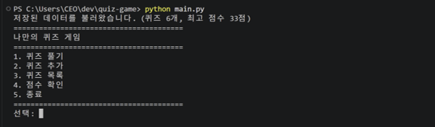
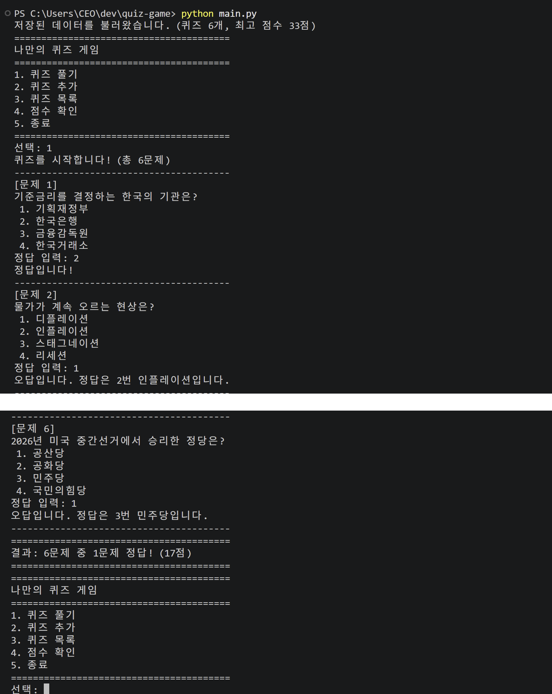
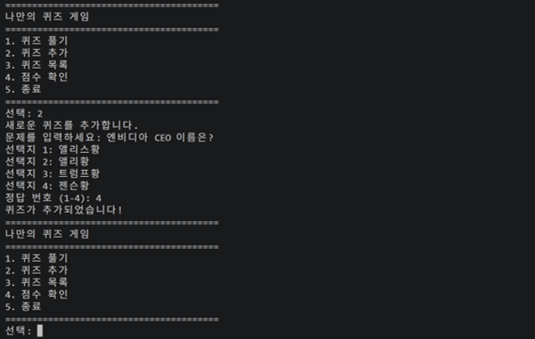
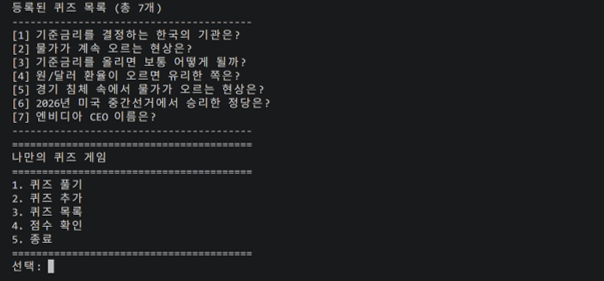
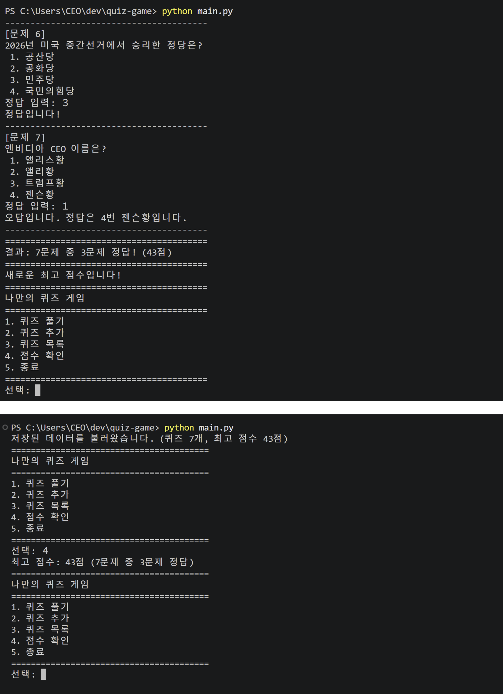
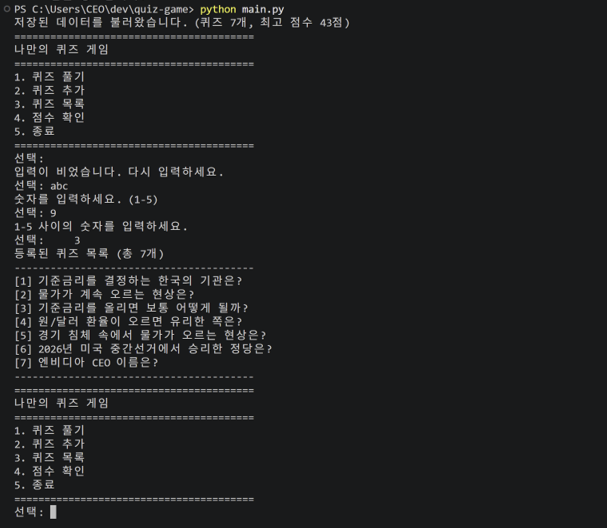

# 나만의 퀴즈 게임

## 1. 프로젝트 개요
터미널에서 실행하는 4지선다형 경제 상식 퀴즈 게임입니다.
Python 표준 라이브러리만 사용하며, 퀴즈와 최고 점수는 `state.json`에 저장되어 프로그램을 다시 실행해도 유지됩니다.

## 2. 퀴즈 주제와 선정 이유
- 주제: 경제 상식 (기준금리, 물가, 환율, 경기)
- 선정 이유: 금리·물가·환율은 뉴스에 매일 나오고 대출, 예금, 장보기처럼 생활과 바로 연결되는 개념입니다. 용어는 자주 듣지만 정확한 뜻은 헷갈리기 쉬워서, 퀴즈로 풀며 개념을 확실히 익히기 좋은 주제라고 생각해 골랐습니다.

## 3. 실행 방법
- 필요 환경: Python 3.10 이상 (외부 라이브러리 없음)
- 프로젝트 폴더에서 실행:

```
python main.py
```

(Mac/Linux는 `python3 main.py`)

## 4. 기능 목록
| 메뉴 | 기능 | 설명 |
|---|---|---|
| 1 | 퀴즈 풀기 | 등록된 퀴즈를 모두 출제하고 정답/오답(오답 시 정답 번호와 내용)과 최종 점수(100점 만점)를 보여줌 |
| 2 | 퀴즈 추가 | 문제, 선택지 4개, 정답 번호를 입력받아 바로 저장 |
| 3 | 퀴즈 목록 | 등록된 문제를 번호와 함께 표시 |
| 4 | 점수 확인 | 최고 점수와 당시 맞힌 문제 수 표시, 더 높은 점수가 나오면 갱신 |
| 5 | 종료 | 데이터를 저장하고 종료 |

예외 처리
- 입력 앞뒤 공백 제거
- 빈 입력, 문자 입력, 범위 밖 숫자 → 안내 후 다시 입력
- Ctrl+C / 입력 종료(EOF) → 오류 화면 없이 저장 후 안전 종료
- `state.json`이 없으면 기본 퀴즈 5개로 시작
- `state.json`이 손상되면(JSON 문법 오류, 키 누락, 선택지 4개가 아님, 정답이 1~4가 아님 등) 안내 후 기본 퀴즈로 복구
- 퀴즈 추가·풀기 도중 중단하면 입력하던 퀴즈와 그 판의 점수는 저장하지 않음 (완료된 데이터만 저장)

## 5. 파일 구조
```
quiz-game/
├─ main.py            # 실행 시작점 (QuizGame().run() 호출)
├─ quiz.py            # Quiz 클래스: 퀴즈 1개의 출력, 채점, dict 변환
├─ quiz_game.py       # QuizGame 클래스: 메뉴, 게임 진행, 저장/불러오기
├─ README.md
├─ .gitignore         # state.json, __pycache__ 등 업로드 제외
├─ docs/
│  └─ screenshots/    # 실행 화면 캡처
└─ state.json         # 실행 시 자동 생성 (저장소에는 없음)
```

클래스 구성
- `Quiz`: question, choices, answer / display(), is_correct(), to_dict(), from_dict()
- `QuizGame`
  - 상태: quizzes, best_score, best_correct, best_total
  - 입력 처리: get_number(), get_text()
  - 화면/메뉴: show_menu(), run()
  - 게임 진행: play_quiz(), add_quiz(), list_quizzes(), show_score()
  - 저장 로직: load_state(), save_state(), reset_to_default(), is_valid_quiz_data()

## 6. 데이터 파일 설명 (state.json)
- 경로: 프로젝트 루트의 `state.json` (실행 시 자동 생성, `.gitignore`로 업로드 제외)
- 역할: 퀴즈 목록과 최고 점수를 보관해 다시 실행해도 유지
- 인코딩: UTF-8
- 저장 시점: 퀴즈 추가 직후, 최고 점수 갱신 직후, 종료 시

```json
{
  "quizzes": [
    {
      "question": "기준금리를 결정하는 한국의 기관은?",
      "choices": ["기획재정부", "한국은행", "금융감독원", "한국거래소"],
      "answer": 2
    }
  ],
  "best_score": 80,
  "best_correct": 4,
  "best_total": 5
}
```

| 키 | 자료형 | 뜻 |
|---|---|---|
| quizzes | list | 퀴즈 목록. question(문자열), choices(문자열 4개), answer(1~4) |
| best_score | int 또는 null | 최고 점수(100점 만점). 기록이 없으면 null |
| best_correct | int 또는 null | 최고 점수 당시 맞힌 문제 수 |
| best_total | int 또는 null | 최고 점수 당시 전체 문제 수 |

## 실행 화면
### 메뉴

### 퀴즈 풀기

### 퀴즈 추가

### 퀴즈 목록

### 점수 확인

### 잘못된 입력 처리

### 재실행 후 데이터 유지
