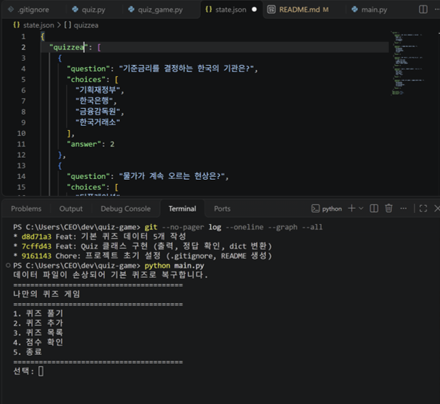
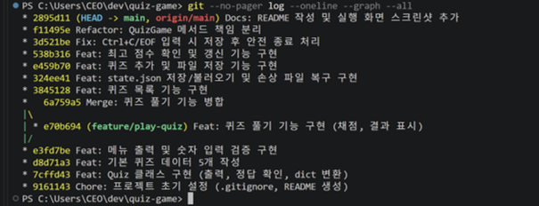
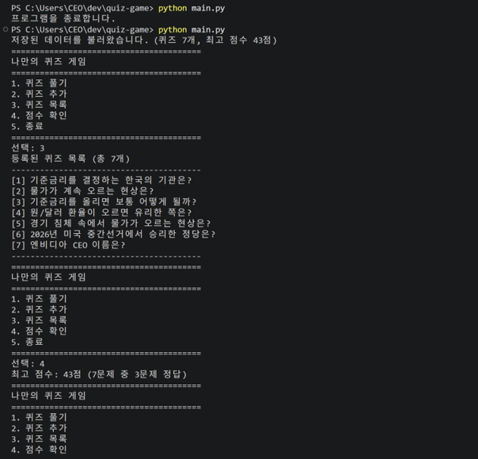

# 나만의 퀴즈 게임

## 1. 프로젝트 개요
터미널에서 실행하는 4지선다형 경제 상식 퀴즈 게임입니다.
Python 표준 라이브러리만 사용하며, 퀴즈와 최고 점수는 `state.json`에 저장되어 프로그램을 다시 실행해도 유지됩니다.

## 2. 퀴즈 주제와 선정 이유
- 주제: 경제 상식 (기준금리, 물가, 환율, 경기)
- 선정 이유: 금리·물가·환율은 뉴스에 매일 나오고 대출, 예금, 장보기처럼 생활과 바로 연결되는 개념입니다. 용어는 자주 듣지만 정확한 뜻은 헷갈리기 쉬워서, 퀴즈로 풀며 개념을 확실히 익히기 좋은 주제라고 생각해 골랐습니다.

## 3. 실행 방법
- 필요 환경: Python 3.10 이상 (외부 라이브러리 없음)
- 프로젝트 폴더에서 실행:

```
python main.py
```

(Mac/Linux는 `python3 main.py`)

## 4. 기능 목록
| 메뉴 | 기능 | 설명 |
|---|---|---|
| 1 | 퀴즈 풀기 | 등록된 퀴즈를 모두 출제하고 정답/오답(오답 시 정답 번호와 내용)과 최종 점수(100점 만점)를 보여줌 |
| 2 | 퀴즈 추가 | 문제, 선택지 4개, 정답 번호를 입력받아 바로 저장 |
| 3 | 퀴즈 목록 | 등록된 문제를 번호와 함께 표시 |
| 4 | 점수 확인 | 최고 점수와 당시 맞힌 문제 수 표시, 더 높은 점수가 나오면 갱신 |
| 5 | 종료 | 데이터를 저장하고 종료 |

예외 처리
- 입력 앞뒤 공백 제거
- 빈 입력, 문자 입력, 범위 밖 숫자 → 안내 후 다시 입력
- Ctrl+C / 입력 종료(EOF) → 오류 화면 없이 저장 후 안전 종료
- `state.json`이 없으면 기본 퀴즈 5개로 시작
- `state.json`이 손상되면(JSON 문법 오류, 키 누락, 선택지 4개가 아님, 정답이 1~4가 아님 등) 안내 후 기본 퀴즈로 복구




- 퀴즈 추가·풀기 도중 중단하면 입력하던 퀴즈와 그 판의 점수는 저장하지 않음 (완료된 데이터만 저장)

## 5. 파일 구조
```
quiz-game/
├─ main.py            # 실행 시작점 (QuizGame().run() 호출)
├─ quiz.py            # Quiz 클래스: 퀴즈 1개의 출력, 채점, dict 변환
├─ quiz_game.py       # QuizGame 클래스: 메뉴, 게임 진행, 저장/불러오기
├─ README.md
├─ .gitignore         # state.json, __pycache__ 등 업로드 제외
├─ docs/
│  └─ screenshots/    # 실행 화면 캡처
└─ state.json         # 실행 시 자동 생성 (저장소에는 없음)
```

클래스 구성
- `Quiz`: question, choices, answer / display(), is_correct(), to_dict(), from_dict()
- `QuizGame`
  - 상태: quizzes, best_score, best_correct, best_total
  - 입력 처리: get_number(), get_text()
  - 화면/메뉴: show_menu(), run()
  - 게임 진행: play_quiz(), add_quiz(), list_quizzes(), show_score()
  - 저장 로직: load_state(), save_state(), reset_to_default(), is_valid_quiz_data()

### Quiz 클래스 (quiz.py)
퀴즈 1개(문제, 선택지 4개, 정답 번호)를 담는 클래스입니다. 화면 출력, 채점, `state.json` 저장용 dict 변환을 맡습니다.

```python
class Quiz:
    def __init__(self, question, choices, answer):
        self.question = question   # 문제
        self.choices = choices     # 선택지 4개 리스트
        self.answer = answer       # 정답 번호 (1~4)

    def display(self, number):
        print(f"[문제 {number}]")
        print(self.question)
        for i, choice in enumerate(self.choices, start=1):
            print(f" {i}. {choice}")

    def is_correct(self, user_answer):
        return user_answer == self.answer

    def to_dict(self):
        return {"question": self.question, "choices": self.choices, "answer": self.answer}

    @classmethod
    def from_dict(cls, data):
        return cls(data["question"], data["choices"], data["answer"])
```

| 메서드 | 역할 |
|---|---|
| `__init__` | 문제, 선택지, 정답 번호를 저장 |
| `display(number)` | "[문제 N]"과 문제, 선택지 1~4를 출력 |
| `is_correct(user_answer)` | 사용자가 고른 번호가 정답인지 True/False로 반환 |
| `to_dict()` | `state.json`에 저장할 수 있도록 dict로 변환 |
| `from_dict(data)` | `state.json`에서 읽은 dict로 Quiz 객체를 다시 만듦 |

### QuizGame 클래스 (quiz_game.py)
게임 전체를 관리하는 클래스입니다. 한 메서드가 한 가지 일만 하도록 역할별로 나눴습니다.

| 역할 | 메서드 | 하는 일 |
|---|---|---|
| 초기화 | `__init__()` | 기본값을 준비한 뒤 `state.json`을 불러옴 |
| 입력 처리 | `get_number(prompt, min_value, max_value)` | 숫자 입력 공통 함수. 공백 제거, 빈 입력·문자·범위 밖 숫자는 안내 후 다시 입력 (메뉴, 정답 입력, 정답 번호 입력에서 재사용) |
| 입력 처리 | `get_text(prompt)` | 글자 입력 공통 함수. 공백 제거, 빈 입력은 안내 후 다시 입력 |
| 화면/메뉴 | `show_menu()` | 메뉴 1~5 출력 |
| 화면/메뉴 | `run()` | 메뉴 반복 실행, 번호별 기능 호출, Ctrl+C/EOF 시 저장 후 종료 |
| 게임 진행 | `play_quiz()` | 퀴즈 출제, 채점, 점수 계산, 최고 점수 갱신 |
| 게임 진행 | `add_quiz()` | 새 퀴즈 입력받아 추가 후 저장 |
| 게임 진행 | `list_quizzes()` | 퀴즈 목록 출력 |
| 게임 진행 | `show_score()` | 최고 점수 출력 |
| 저장 로직 | `load_state()` | `state.json` 불러오기 (없음/손상/읽기 오류 처리) |
| 저장 로직 | `save_state()` | `state.json`에 저장 |
| 저장 로직 | `reset_to_default()` | 기본 퀴즈와 빈 점수 기록으로 되돌림 |
| 저장 로직 | `is_valid_quiz_data(item)` | 불러온 퀴즈 데이터가 올바른 형식인지 검사 |

입력 처리 예시: 숫자 검사는 모두 `get_number()` 하나로 처리하므로 같은 코드가 반복되지 않습니다.

```python
def get_number(self, prompt, min_value, max_value):
    while True:
        text = input(prompt).strip()
        if text == "":
            print("입력이 비었습니다. 다시 입력하세요.")
            continue
        try:
            number = int(text)
        except ValueError:
            print(f"숫자를 입력하세요. ({min_value}-{max_value})")
            continue
        if not (min_value <= number <= max_value):
            print(f"{min_value}-{max_value} 사이의 숫자를 입력하세요.")
            continue
        return number
```

## 6. 데이터 파일 설명 (state.json)
- 경로: 프로젝트 루트의 `state.json` (실행 시 자동 생성, `.gitignore`로 업로드 제외)
- 역할: 퀴즈 목록과 최고 점수를 보관해 다시 실행해도 유지
- 인코딩: UTF-8
- 저장 시점: 퀴즈 추가 직후, 최고 점수 갱신 직후, 종료 시
- 불러오는 시점: 프로그램 시작 시 자동으로 불러옴 (없으면 기본 퀴즈, 손상되면 기본 퀴즈로 복구)

```json
{
  "quizzes": [
    {
      "question": "기준금리를 결정하는 한국의 기관은?",
      "choices": [
        "기획재정부",
        "한국은행",
        "금융감독원",
        "한국거래소"
      ],
      "answer": 2
    },
    {
      "question": "물가가 계속 오르는 현상은?",
      "choices": [
        "디플레이션",
        "인플레이션",
        "스태그네이션",
        "리세션"
      ],
      "answer": 2
    },
    {
      "question": "기준금리를 올리면 보통 어떻게 될까?",
      "choices": [
        "대출이 늘어난다",
        "물가가 급등한다",
        "예금 금리가 오른다",
        "환율이 무조건 오른다"
      ],
      "answer": 3
    },
    {
      "question": "원/달러 환율이 오르면 유리한 쪽은?",
      "choices": [
        "수출 기업",
        "해외여행객",
        "수입 기업",
        "해외 유학생"
      ],
      "answer": 1
    },
    {
      "question": "경기 침체 속에서 물가가 오르는 현상은?",
      "choices": [
        "인플레이션",
        "디플레이션",
        "스태그플레이션",
        "리플레이션"
      ],
      "answer": 3
    }
  ],
  "best_score": null,
  "best_correct": null,
  "best_total": null
}
```

| 키 | 자료형 | 뜻 |
|---|---|---|
| quizzes | list | 퀴즈 목록. question(문자열), choices(문자열 4개), answer(1~4) |
| best_score | int 또는 null | 최고 점수(100점 만점). 기록이 없으면 null |
| best_correct | int 또는 null | 최고 점수 당시 맞힌 문제 수 |
| best_total | int 또는 null | 최고 점수 당시 전체 문제 수 |

### 파일 경로: 프로젝트 루트
코드 파일(quiz_game.py)이 있는 폴더를 기준으로 경로를 만들어, 어느 위치에서 실행해도 항상 프로젝트 루트에 `state.json`이 생깁니다.

```python
from pathlib import Path

STATE_PATH = Path(__file__).parent / "state.json"
```

### 저장: UTF-8
`encoding="utf-8"`로 파일을 열고, `ensure_ascii=False`로 한글을 그대로 저장합니다. `indent=2`는 사람이 읽기 좋게 줄을 나눕니다.

```python
def save_state(self):
    data = {
        "quizzes": [quiz.to_dict() for quiz in self.quizzes],
        "best_score": self.best_score,
        "best_correct": self.best_correct,
        "best_total": self.best_total,
    }
    try:
        with open(STATE_PATH, "w", encoding="utf-8") as f:
            json.dump(data, f, ensure_ascii=False, indent=2)
    except OSError:
        print("데이터를 저장하지 못했습니다.")
```

### 불러오기: UTF-8 + 예외 처리
읽을 때도 `encoding="utf-8"`을 지정합니다. 파일이 없거나 손상된 경우를 나눠서 처리합니다.

```python
def load_state(self):
    if not STATE_PATH.exists():
        print("저장된 데이터가 없어 기본 퀴즈로 시작합니다.")
        return
    try:
        with open(STATE_PATH, "r", encoding="utf-8") as f:
            data = json.load(f)
        quizzes = []
        for item in data["quizzes"]:
            if not self.is_valid_quiz_data(item):
                raise ValueError("잘못된 퀴즈 데이터")
            quizzes.append(Quiz.from_dict(item))
        self.quizzes = quizzes
        self.best_score = data.get("best_score")
        self.best_correct = data.get("best_correct")
        self.best_total = data.get("best_total")
        if self.best_score is None:
            score_text = "최고 점수 없음"
        else:
            score_text = f"최고 점수 {self.best_score}점"
        print(f"저장된 데이터를 불러왔습니다. (퀴즈 {len(self.quizzes)}개, {score_text})")
    except (json.JSONDecodeError, KeyError, TypeError, ValueError):
        print("데이터 파일이 손상되어 기본 퀴즈로 복구합니다.")
        self.reset_to_default()
        self.save_state()
    except OSError:
        print("데이터 파일을 읽을 수 없어 기본 퀴즈로 시작합니다.")
        self.reset_to_default()
```

| 상황 | 처리 |
|---|---|
| 파일 없음 (첫 실행) | 기본 퀴즈로 시작 |
| JSON 문법 오류 / 키 누락 / 형식 이상 | 안내 후 기본 퀴즈로 복구하고 다시 저장 |
| 파일 읽기 오류 (권한 등) | 안내 후 기본 퀴즈로 시작 |
| 정상 | 퀴즈 개수와 최고 점수를 안내하고 불러옴 |

## 7. Git 작업 기록

### 커밋 목록 (총 14개: 일반 커밋 13개 + 병합 커밋 1개)
기능 단위로 나눠 커밋했으며, 메시지 앞에 작업 종류(Chore/Feat/Merge/Fix/Refactor/Docs)를 붙였습니다.

| 순서 | 커밋 | 메시지 | 내용 |
|---|---|---|---|
| 1 | 9161143 | Chore: 프로젝트 초기 설정 (.gitignore, README 생성) | 저장소 생성, 업로드 제외 파일 설정 |
| 2 | 7cffd43 | Feat: Quiz 클래스 구현 (출력, 정답 확인, dict 변환) | quiz.py 작성 |
| 3 | d8d71a3 | Feat: 기본 퀴즈 데이터 5개 작성 | 경제 상식 퀴즈 5개 |
| 4 | e3fd7be | Feat: 메뉴 출력 및 숫자 입력 검증 구현 | show_menu, get_number, run 뼈대 |
| 5 | e70b694 | Feat: 퀴즈 풀기 기능 구현 (채점, 결과 표시) | feature/play-quiz 브랜치에서 작업 |
| 6 | 6a759a5 | Merge: 퀴즈 풀기 기능 병합 | 브랜치를 main에 병합 |
| 7 | 3845128 | Feat: 퀴즈 목록 기능 구현 | list_quizzes |
| 8 | 324ee41 | Feat: state.json 저장/불러오기 및 손상 파일 복구 구현 | load_state, save_state |
| 9 | e459b70 | Feat: 퀴즈 추가 및 파일 저장 기능 구현 | add_quiz, get_text |
| 10 | 538b316 | Feat: 최고 점수 확인 및 갱신 기능 구현 | show_score, 최고 점수 갱신 |
| 11 | 3d521be | Fix: Ctrl+C/EOF 입력 시 저장 후 안전 종료 처리 | run에 예외 처리 추가 |
| 12 | f11495e | Refactor: QuizGame 메서드 책임 분리 | 구조 정리 |
| 13 | 2895d11 | Docs: README 작성 및 실행 화면 스크린샷 추가 | README.md, docs/screenshots |

### 브랜치 생성 및 병합
퀴즈 풀기 기능은 `main`이 아닌 별도 브랜치에서 개발한 뒤 병합했습니다.

```
git checkout -b feature/play-quiz      # 브랜치 생성 후 이동
# play_quiz() 구현 후 커밋
git checkout main                      # main으로 돌아오기
git merge --no-ff feature/play-quiz    # 병합 기록을 남기며 병합
git push
```

`--no-ff` 옵션을 사용해 병합 커밋을 따로 남겼습니다. 그래서 아래 그래프에서 브랜치가 갈라졌다가(`|\`) 합쳐지는(`|/`) 모양을 확인할 수 있습니다.

```
* 2895d11 (HEAD -> main, origin/main) Docs: README 작성 및 실행 화면 스크린샷 추가
* f11495e Refactor: QuizGame 메서드 책임 분리
* 3d521be Fix: Ctrl+C/EOF 입력 시 저장 후 안전 종료 처리
* 538b316 Feat: 최고 점수 확인 및 갱신 기능 구현
* e459b70 Feat: 퀴즈 추가 및 파일 저장 기능 구현
* 324ee41 Feat: state.json 저장/불러오기 및 손상 파일 복구 구현
* 3845128 Feat: 퀴즈 목록 기능 구현
*   6a759a5 Merge: 퀴즈 풀기 기능 병합
|\
| * e70b694 (feature/play-quiz) Feat: 퀴즈 풀기 기능 구현 (채점, 결과 표시)
|/
* e3fd7be Feat: 메뉴 출력 및 숫자 입력 검증 구현
* d8d71a3 Feat: 기본 퀴즈 데이터 5개 작성
* 7cffd43 Feat: Quiz 클래스 구현 (출력, 정답 확인, dict 변환)
* 9161143 Chore: 프로젝트 초기 설정 (.gitignore, README 생성)
```



### 사용한 Git 명령어
| 명령어 | 사용한 곳 |
|---|---|
| `git init` | 프로젝트 폴더를 Git 저장소로 만들기 |
| `git add` | 변경한 파일을 커밋 대상으로 올리기 |
| `git commit` | 기능 단위로 변경 기록 남기기 |
| `git push` | GitHub 원격 저장소에 올리기 |
| `git checkout` | 브랜치 생성(`-b`) 및 브랜치 이동 |
| `git merge` | feature/play-quiz 브랜치를 main에 병합 |
| `git clone` | 저장소를 다른 폴더에 복제 (clone/pull 실습) |
| `git pull` | 복제본에서 올린 변경을 원래 폴더로 받아오기 (clone/pull 실습) |

## 실행 화면
### 메뉴

### 퀴즈 풀기

### 퀴즈 추가

### 퀴즈 목록

### 점수 확인

### 잘못된 입력 처리

### 재실행 후 데이터 유지



## 8. clone/pull 실습
- 저장소를 별도 폴더(quiz-game-clone)에 `git clone`으로 복제
- 복제본에서 README에 이 섹션을 추가한 뒤 `commit` → `push`
- 기존 작업 폴더(quiz-game)에서 `git pull`로 변경사항을 받아와 반영 확인